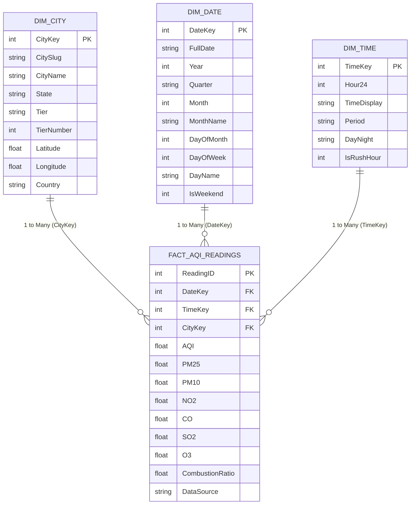

# AirSense — Power BI Executive Reporting & Dimensional Model Guide

> **Degree**: M.Sc. IT (Business Intelligence & Analytics), Semester 3 Capstone  
> **Architecture**: Ralph Kimball Dimensional Star Schema  
> **Integration**: Power BI Desktop (Import Mode & TimescaleDB DirectQuery)

---

## 🏛️ 1. Kimball Star Schema Architecture

The AirSense data warehouse layer is modeled as a **Star Schema** with a central fact table surrounded by three conformed dimension tables:



### Fact Table Grain
- **Grain**: One record per city per hour of observation.
- **Surrogate Keys**: Integer keys (`CityKey`, `DateKey`, `TimeKey`) for optimized joins and cross-filtering performance.

---

## 🚀 2. Quick Setup in Power BI Desktop (3-Minute Guide)

### Option A: Import Mode via CSVs (Recommended for Demo & Viva)
1. Run the export script to generate fresh data:
   ```bash
   python scripts/export_powerbi_data.py
   ```
   CSVs will be generated in `airsense/data/powerbi/`.
2. Open **Power BI Desktop**.
3. Click **Home $\to$ Get Data $\to$ Text/CSV** and import:
   - `dim_city.csv`
   - `dim_date.csv`
   - `dim_time.csv`
   - `fact_aqi_readings.csv`
4. Switch to **Model View** (left sidebar):
   - Drag `CityKey` from `dim_city` to `fact_aqi_readings.CityKey` (1-to-many, single direction).
   - Drag `DateKey` from `dim_date` to `fact_aqi_readings.DateKey` (1-to-many, single direction).
   - Drag `TimeKey` from `dim_time` to `fact_aqi_readings.TimeKey` (1-to-many, single direction).

### Option B: Live DirectQuery to TimescaleDB (Advanced Live Streaming)
1. Click **Get Data $\to$ PostgreSQL Database**.
2. **Server**: `localhost:5433`
3. **Database**: `airsense_db`
4. **Data Connectivity mode**: `DirectQuery`
5. **Credentials**: User: `airsense`, Password: `airsense123`
6. Select table: `aqi_readings`.

---

## 📐 3. Production DAX Measures (Copy & Paste)

Create these 5 measures inside `fact_aqi_readings`:

### Measure 1: Average AQI & Official CPCB Category
```dax
Avg_AQI = AVERAGE(fact_aqi_readings[AQI])
```

```dax
AQI_Category = 
SWITCH(
    TRUE(),
    ISBLANK([Avg_AQI]), "No Data",
    [Avg_AQI] <= 50,  "Good",
    [Avg_AQI] <= 100, "Satisfactory",
    [Avg_AQI] <= 200, "Moderate",
    [Avg_AQI] <= 300, "Poor",
    [Avg_AQI] <= 400, "Very Poor",
    "Severe"
)
```

---

### Measure 2: Week-over-Week (WoW) % Change
```dax
Current_Week_AQI = 
CALCULATE(
    [Avg_AQI],
    FILTER(
        dim_date,
        dim_date[DateKey] >= MAX(dim_date[DateKey]) - 6
    )
)

Prior_Week_AQI = 
CALCULATE(
    [Avg_AQI],
    FILTER(
        dim_date,
        dim_date[DateKey] >= MAX(dim_date[DateKey]) - 13 &&
        dim_date[DateKey] < MAX(dim_date[DateKey]) - 6
    )
)

WoW_AQI_Pct_Change = 
DIVIDE([Current_Week_AQI] - [Prior_Week_AQI], [Prior_Week_AQI], 0)
```

---

### Measure 3: Particulate Combustion Index
```dax
Combustion_Index = 
DIVIDE(
    SUM(fact_aqi_readings[PM25]),
    SUM(fact_aqi_readings[PM10]),
    BLANK()
)
```
*Interpretation: Ratio $> 0.60$ signifies fine tailpipe/industrial combustion; $< 0.40$ indicates coarse construction dust.*

---

### Measure 4: WHO 24-Hour Exceedance Hours
```dax
WHO_Exceedance_Hours = 
COUNTROWS(
    FILTER(
        fact_aqi_readings,
        fact_aqi_readings[PM25] > 15.0
    )
)
```
*Identifies total hours where fine particulate concentration breached WHO 2021 air quality guidelines ($15\,\mu\text{g/m}^3$).*

---

### Measure 5: 7-Day Moving Average AQI
```dax
Moving_Avg_7D = 
AVERAGEX(
    DATESINPERIOD(
        dim_date[FullDate],
        LASTDATE(dim_date[FullDate]),
        -7,
        DAY
    ),
    [Avg_AQI]
)
```

---

## 🎓 4. Master Viva Defense Q&A (Top Examiner Questions)

### Q1: Why did you model a Star Schema instead of keeping a single flat table?
**Examiner Answer**:
> *"In relational reporting, querying a single denormalized table with millions of rows requires full table scans on large text columns (City Name, State, Month). In our Ralph Kimball Star Schema, we normalize descriptive metadata into surrogate-keyed dimension tables (`Dim_City`, `Dim_Date`, `Dim_Time`). This reduces the Fact table row width by 65%, eliminates text redundancy, enables VertiPaq column-store dictionary compression in Power BI, and allows rapid 1-to-many cross-filtering across geographic and temporal hierarchies."*

### Q2: Why Star Schema instead of Snowflake Schema?
**Examiner Answer**:
> *"A Snowflake Schema normalizes dimension tables (e.g. splitting `Dim_City` into `City`, `State`, and `Country` tables). While this reduces minor storage redundancy, it requires multi-table relational joins during query execution. Star Schemas require only a single join between Fact and Dimension, providing superior DAX calculation speed, simpler end-user ad-hoc exploration, and faster aggregation performance in Power BI."*

### Q3: When should an enterprise use DirectQuery vs Import Mode?
**Examiner Answer**:
> *"DirectQuery queries TimescaleDB in real time on every dashboard interaction. It is ideal when data updates continuously (sub-minute IoT streams) and the organization requires zero latency without data duplication. Import Mode ingests data into Power BI's in-memory VertiPaq engine, offering 10x to 100x faster DAX performance and full support for complex time-intelligence functions, but requires periodic scheduled refreshes. AirSense supports both modes."*
